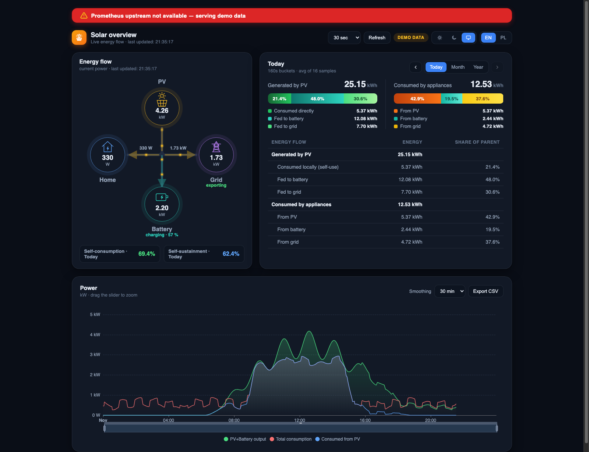

# Solar Energy Flow dashboard

> **Experimental — work in progress.** The whole pv-suite is still under
> active development: interfaces, file formats and behavior can still change
> at any time.

A single-page dashboard for home PV monitoring, fed by Prometheus. Part of
the **pv-suite** family — the scraper, cache proxy, fake inverter and
packaging overview live in the [suite root](../README.md).



## Features

- **Flow diagram** — live PV / Load / Grid nodes with animated energy
  particles (orange = solar, violet = grid import; speed and particle rate
  follow the power). Grid value is computed as **export − import** from the
  configured `gridExport` / `gridImport` metrics: **negative = import,
  positive = export**.
- **Energy summary** — generated by PV, consumed by appliances,
  self-consumption vs fed-to-grid, with percentage bars, an energy table
  and a zoomable time-series chart.
- **CSV export** — energy in **watt-hours** (integrated from every
  Prometheus bucket in the period — same math as the table) for PV Yield,
  Home, Grid Export and Grid Import, zero-filled over the full period:
  hourly (day view), daily (month view), monthly (year view), per-year for
  "All time", plus an hourly detailed export for a whole month. ISO 8601
  timestamps.
- **Battery** — `battery: true` in `config.js`
  joins a Battery node to the flow diagram (teal particles: up =
  discharging, down = charging, a SoC % line), splits the energy three-way
  (PV / battery / grid) and adds the CSV columns. Without a working
  battery selector (missing metric or a constant `0`), the node dims and a
  warning banner appears.
  **Untested against real hardware** — verified only against simulated
  data so far.
- **Theme** (dark / light / system) and **language** (EN / PL; add a
  language as `de: { ... }` in `i18n.js` — it appears in the switcher
  automatically) in the header, persisted in localStorage.
- If Prometheus is unreachable, the page switches to **DEMO DATA** so you
  can preview the layout.

## Run

**Recommended (proxy mode, no CORS issues):** `bin/dashboard.py` serves
the page and proxies `/prom/*` to your Prometheus — the browser never
talks to Prometheus directly:

```bash
python3 bin/dashboard.py                          # upstream http://localhost:9090
python3 bin/dashboard.py --listen 127.0.0.1:8080 --upstream http://192.168.1.50:9090
PROM_URL=http://pi:9090 python3 bin/dashboard.py  # via env
# open http://localhost:8080
```

By default the server **binds to `127.0.0.1:8080`** (loopback only) — pass
`--listen 0.0.0.0:8080` to serve the LAN. The page and the proxy speak the
family's F13 shape (the audit's F21): a **bearer token is mandatory beyond
loopback** — a token-less non-loopback bind refuses to start. Set
`--auth-token` (or `file:<path>`); the browser opens
`http://host:8080/?auth=<token>` once — the exchange sets an HttpOnly
session cookie — and scripts send `Authorization: Bearer <token>`. On the
loopback bind the token is optional. Beyond localhost, still terminate TLS
at an authenticating proxy (below).

**Static-only mode:** any web server works
(`python3 -m http.server 8080 -d static`), but then set `prometheusUrl` in
`config.js` to the direct Prometheus URL — the browser fetches it
directly, which requires CORS to be allowed.

## Configuration

All settings live in `config.js` (the shipped example is
`examples/config.js`, served at `/config.js`; relocate with `--config-js`,
`$CONFIG_JS` or `set config-js <file>` in `server.conf` — if the override
file is missing, `/config.js` 404s and the page boots with built-in
defaults):

```js
const SOLAR_CONFIG = {
  prometheusUrl: '/prom',
  battery: true,
  metrics: {
    pv: 'huawei_pv_generation_watts{job="sun2000"}',
    gridExport: 'huawei_grid_export_watts{job="sun2000"}',
    gridImport: 'huawei_grid_import_watts{job="sun2000"}',
    load: 'huawei_home_consumption_watts{job="sun2000"}',
    battery: 'huawei_battery_net_watts{job="sun2000"}',
    batterySoC: 'huawei_battery_soc_percent{job="sun2000"}'
  },
  scrapeSec: 10,
  smoothMin: 30,
  refreshSec: 30,
  defaultLang: 'en',
  enableAllTime: false
};
```

| Key | Meaning |
|---|---|
| `prometheusUrl` | `/prom` (the same-origin proxy) or a direct Prometheus URL |
| `metrics` | the full metric selectors — label matchers are passed through to PromQL; values always in **watts**. `gridExport` = export power (≥ 0); with `gridImport` set, the net grid value is `export − import` |
| `battery` | the battery panels' master switch (the selectors: `metrics.battery` signed W / `metrics.batterySoC` %; an optional `metrics.batteryFlag` present-flag for exporters that have one) |
| `scrapeSec` | the Prometheus scrape interval in seconds (bucket size) |
| `smoothMin` | display smoothing window in minutes (0 = raw) |
| `refreshSec` | the default auto-refresh interval (the header combo overrides; 0 = off) |
| `defaultLang` | the default UI language (`en`/`pl`) |
| `enableAllTime` | show the "All time" selector (for a long-retention backend); `?all` also works |
| `liveSec` / `chartSec` | the flow-diagram / chart-panel refresh intervals |

URL params
(`?prom=…&gridExport=…&grid=…&gridImport=…&pv=…&load=…&battery=1&batteryMetric=…&batterySoC=…&batteryFlag=…&scrape=…&smooth=…&refresh=…&lang=…&demoHour=…&consent=0`)
override `config.js` for quick testing. `config.js` and `i18n.js`
locations are configurable (`?config=<path>` / `?i18n=<path>`); a failed
load falls back to the files next to the page, then to the built-in
defaults.

The server's settings resolve CLI > env > `server.conf` > defaults — the
env twins are the knobs' bare upper-snake names (`PORT`, `BIND`,
`PROM_URL`, `PROM_PREFIX`, `STATIC_DIR`, `CONFIG_JS`,
`AUTH_TOKEN`, the caps, `LOG_ACCESS`, `CTL`, `CONTROL_TOKEN`, …). The
`server.conf` sample speaks the set grammar (every line a `set <name>
<value>`):

```conf
# the dashboard's server.conf — every line is a set command
set port 8080
set bind 127.0.0.1
# set auth-token file:/path/to/page.token   (mandatory beyond loopback, F21)
set upstream http://localhost:9090
set prom-prefix /prom
set log-level INFO
```

`--prom-prefix ''` (empty) proxies *every* unmatched path to Prometheus.
The HTTP surface carries the family's connection caps (`--max-clients`,
`--max-conn-per-ip`, `--client-timeout`) — all live-settable through the
control server.

| Flag | Default | Meaning |
|---|---|---|
| `--listen` | `127.0.0.1:8080` | the HTTP serve address `HOST:PORT` (loopback by default; beyond loopback `--auth-token` is mandatory, F21) |
| `--upstream` | `http://localhost:9090` | the Prometheus URL the proxy forwards to |
| `--prom-prefix` | `/prom` | the proxy path (empty = proxy everything) |
| `--static-dir` | the packaged `static/` | override the served static directory |
| `--config-js` | the bundled example | the served config.js path (`CONFIG_JS`) |
| `--auth-token` | off | the page's bearer token (the `?auth=` bootstrap sets the cookie); `file:<path>` welcome |
| `--max-clients` / `--client-timeout` / `--max-conn-per-ip` | `64` / `300` / `0` | the HTTP caps (a total cap / the idle kick / the per-IP cap) |
| `--metrics-server` / `--metrics-listen` | off / `127.0.0.1:9353` | the dashboard's own `/metrics` endpoint (a token is mandatory when it is on — F13) |
| `--metrics-token` / `--metrics-acl` | off / `any` | the /metrics bearer (`file:<path>` welcome) / the connect ACL (the ip-prefix grammar — [docs/ACL.md](../docs/ACL.md)) |
| `--metrics-max-clients` / `--metrics-client-timeout` / `--metrics-max-conn-per-ip` | `16` / `5` / `0` | the metrics caps |
| `--control-port` | `/tmp/dashboard-<port>.socket` | the control server target (unix path or TCP port), `0` = off |
| `--control-token` / `--control-ops-token` | off | the control tokens (a TCP control port refuses to start without the admin token, F5); `file:<path>` welcome |
| `--control-ops-verbs` | `show,clear` | the read-only ops role's RBAC policy |
| `--control-trust-uids` / `--control-socket-group` | none / off | the unix socket's extra trusted uids (`SO_PEERCRED`) / its 0660 group-accessible mode |
| `--dump-path` / `--dump-key` / `--dump-interval` / `--restore-on-start` | off | the sealed state dump (the live overrides; `request dump`/`restore`, every `--dump-interval` seconds) |
| `--audit-log` (+ `--audit-max-mb`, `--audit-daily`, `--audit-files`, `--no-audit-log`, `--audit-forward`, `--audit-forward-format`) | the XDG state home | the DSH audit trail: a file path, `-` for stdout (the docker logs / journald way) or `none` (no local file — the forward carries the trail) + the rotation/off + the forward (F10) |
| `--log-level` / `--log-queries` / `--log-access` / `--local-time` | `INFO` / off / off / UTC | the log surface (`--log-queries` logs the proxied Prometheus queries at INFO) |

## Control

The server speaks the family's JSON-lines control protocol: it listens on
a 0600 unix socket by default (`/tmp/dashboard-<port>.socket`) or a TCP
port on 127.0.0.1 (a token is mandatory there — F5; with a token
configured the wire is HMAC-signed). Over the unix socket a trusted peer
(root, the daemon's own user or `--control-trust-uids`) skips the token
handshake (`SO_PEERCRED`). The **read-only ops token**
(`--control-ops-token`) authenticates into the `show` verbs only — the
ops shift against the admin key, both audited (the DSH trail's COMMAND
entries carry `role=ops`/`role=admin`). Every command and knob the wire
answers — command, settable (`set`/`unset`) or show-only — is tabled in
[MANUAL.md](MANUAL.md) (generated from the registry).

```bash
python3 bin/dashboard.py --control-port /tmp/dashboard-8080.socket &
python3 bin/dashboard-ctl.py show upstream          # one-shot
python3 bin/dashboard-ctl.py request reload-config  # the SIGHUP path
printf 'set log-queries on\nshow config\n' | python3 bin/dashboard-ctl.py
python3 bin/dashboard-cli.py                        # the console: TAB completion, ?, reconnect
```

| Command | Effect |
|---|---|
| `set` / `unset` | the live settings: the caps, `log-access`, `log-queries`, `log-level`, `metrics acl`, `control port` (rebinds the listener live), `control ops verbs`/`trust-uids`/`socket-group` — `system listen` (the serve address, `show system listen` answers it) is startup-only and answers the restart note like the tokens (`control token`, `control ops token`, `metrics token`, `auth token`): pass them by flag/env/config |
| `show <setting>` / `show knobs` / `show connections` | the value / the registry / the live HTTP clients per peer IP |
| `inspect` | the one-page dump for a bug report |
| `request reload-config` | re-read `server.conf` (the SIGHUP path; the listen address and port are bound and stay) |
| `request reload` | the whole-daemon restart that keeps the sets: the live overrides save to `<config>.reload`, the process re-execs and re-applies them once (overridden secrets save as `*** SECRET REMOVED ***`, the reply names them) |
| `request dump` / `request restore` | the state dump (`--dump-path`): the live overrides as one `0600` JSON with an integrity hash; `--dump-key` seals it; the `--dump-interval` loop rewrites it live; every secret value takes a `file:` reference |
| `shutdown` / `help <setting>` | graceful stop / one setting's description |

A SIGHUP or `request reload-config` also clears the live overrides. Every
control command, auth failure, reload and shutdown lands in the audit
trail (prefix `DSH`, default `~/.local/state/dashboard/audit.log`;
`--audit-log -` for stdout — the journald way; the ctl/cli keep their own
`CTL`/`CLI` trails). `--audit-forward` mirrors every line — the
per-writer hash chain included — onward: `syslog` (the local socket
auto-scan), `syslog:/path`, `udp://host[:514]` (RFC5426, best-effort) or
`tcp://host[:514]` (RFC6587 framing) — the **off-box copy** (the F10
answer); the remote envelope rides `--audit-forward-format` (`rfc5424`,
the default, or `cef`), a send failure notes once and the next event
re-arms, and `--audit-log none` (with a forward spelled) is the
remote-only mode — the collector is the sole holder.

## Behind a reverse proxy

The dashboard only makes same-origin GET requests — any proxy works.

**A. Proxy → dashboard.py** (keeps Prometheus hidden):

```nginx
location / { proxy_pass http://127.0.0.1:8080; }   # nginx
```
```caddyfile
solar.example.com { reverse_proxy 127.0.0.1:8080 }  # Caddy
```

Run `bin/dashboard.py --listen 127.0.0.1:8080` so only the proxy reaches it.

**B. Proxy serves static files and routes `/prom` to Prometheus itself:**

```nginx
root /var/www/dashboard;
location /prom/ { proxy_pass http://127.0.0.1:9090/; }  # trailing slash strips prefix
```

`prometheusUrl: '/prom'` works in both cases. Mount at the root (or strip
the prefix); add auth at the proxy if exposed to the internet.

## Metrics source

This page expects PV inverter metrics in Prometheus (`huawei_*_watts` —
the scraper's `--metric-prefix` default). The `scraper/` subproject ships
a dependency-free
Python exporter that polls the inverter over Modbus TCP and serves exactly
those metrics — see [`../scraper/README.md`](../scraper/README.md):

```bash
python3 scraper/bin/modbus-scraper.py --upstream <inverter-lan-ip>:502 --listen 0.0.0.0:9350
```

```yaml
# prometheus.yml — the job name must be "sun2000" (the dashboard filters on it)
scrape_configs:
  - job_name: sun2000
    scrape_interval: 10s          # match scrapeSec in config.js
    static_configs:
      - targets: ['localhost:9350']
```

The inverter accepts only one Modbus TCP client — the `cache/` subproject
is an **experimental** caching proxy that multiplexes that one connection
so the scraper can share it with other tools:
[`../cache/README.md`](../cache/README.md).

## Notes

- Auto-refresh is selectable in the header (30 s / 1 min / 5 min / 30 min /
  custom) and refreshes the flow diagram, chart and table together.
- Energy (kWh) is integrated from `avg_over_time(<metric>[<step>s])`
  buckets, so every raw sample inside a bucket contributes — spikes are
  not lost. The step is always a multiple of `scrapeSec`.
- If the browser blocks direct Prometheus access (CORS), run
  `bin/dashboard.py` — the page then fetches same-origin `/prom` and never
  sees the Prometheus host.
- **Fully offline** — the only external library (Apache-2.0 ECharts 5.5.1)
  is vendored at `static/vendor/echarts.min.js`; no CDN or internet access
  is needed.

## Security

The F21 story is the bind's: **loopback is open, the LAN needs the
bearer token** (a token-less non-loopback bind refuses to start), and
TLS terminates at an authenticating reverse proxy. The HTTP surface
carries the family's connection caps. The page is **fully offline** (the
vendored ECharts is the one dependency) and the audit trail records the
control plane. Static-only deployments expose the bare page — put auth in
front.

## Testing

```bash
python3 tests/dashboard-control-fuzz.py  # hostile JSON against the control server
                                         #   (the main instance serves /metrics; the
                                         #   acl round rides the control)
```

Plus the `/config.js` fuzz pin in the same suite (a bogus override file
must not crash the server). The scenario must end with the server alive
and **zero tracebacks** in the logs.

## Nix / NixOS

```bash
nix run .#dashboard
```

`package.nix` builds the dashboard (`static/` + the wrapped `dashboard`
launcher); `module.nix` adds the **`services.dashboard`** option — the
option map, the secrets discipline, the reload story — documented once in
[docs/NIXOS.md](../docs/NIXOS.md).

## Source layout

| File | Purpose |
|---|---|
| `static/index.html` | markup only — links `style.css`, loads `boot.js`, `app.js`, `config.js`, `i18n.js` |
| `static/app.js` | the whole application (chart, flow animation, i18n, stats) |
| `static/style.css` | all styling (dark/light themes, layout, flow diagram) |
| `static/boot.js` / `static/i18n.js` | the config/i18n loader (must stay in `<head>`) / the translations |
| `static/vendor/echarts.min.js` | vendored ECharts 5.5.1 (Apache-2.0) — no CDN needed |
| `bin/dashboard.py` / `server.conf` | static server + Prometheus proxy (serves `static/` by default) |
| `bin/dashboard-ctl.py` / `bin/dashboard-cli.py` | the control clients: one-shot / batch and the console session |
| `lib/config.py` | settings resolution (CLI > env > the `server.conf` set grammar > defaults) + the control-target resolution |
| `lib/options.json` + `lib/options.py` | the knob registry and its loader (one source for the wire, the completions and the docs) |
| `lib/control.py` | the JSON-lines control server (the signed wire, the peer-cred shortcut) |
| `lib/static.json` / `lib/statics.py` | the shipped server defaults (port, bind, upstream, proxy prefix/timeout) / its loader |
| `examples/config.js` | the user-settings example (`SOLAR_CONFIG`), served at `/config.js` |
| `man/*.1` | the man pages — **generated** (`--man`, `scripts/gen_man.py`) |
| `package.nix` / `module.nix` | Nix packaging and service module (the flake entry point lives at the suite root) |

## License

The dashboard code (server, page, Nix packaging) is licensed under the
**BSD 3-Clause License** — see the `LICENSE` file. The bundled chart
library `static/vendor/echarts.min.js` is
[Apache ECharts](https://echarts.apache.org/) 5.5.1, licensed under the
**Apache License 2.0** (© the Apache Software Foundation); the license
notice is preserved in the vendored file.
